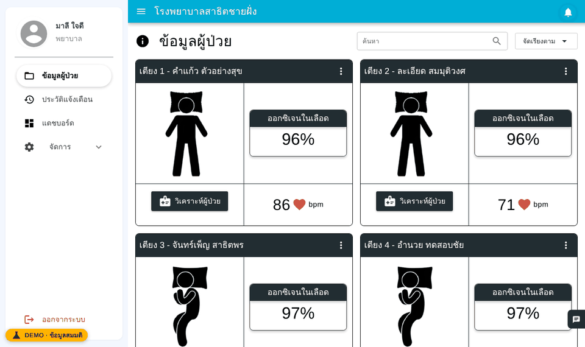
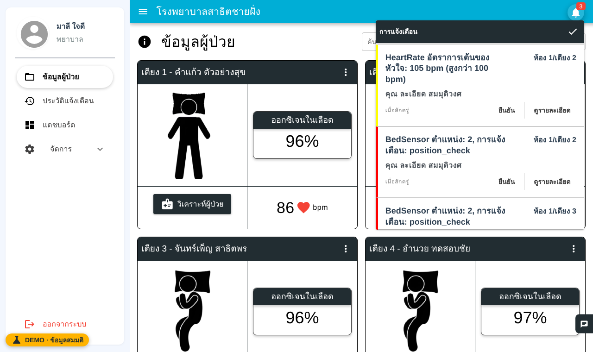
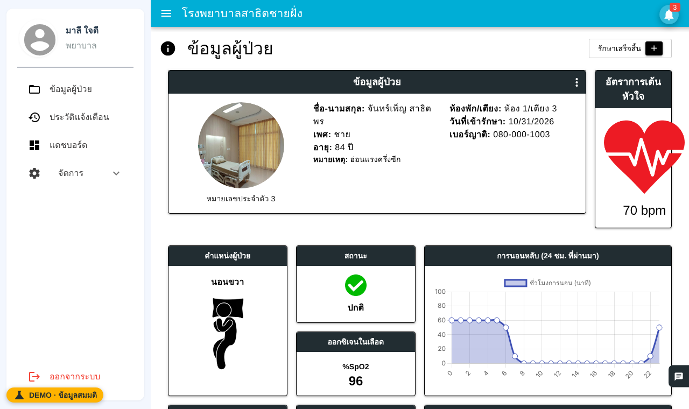
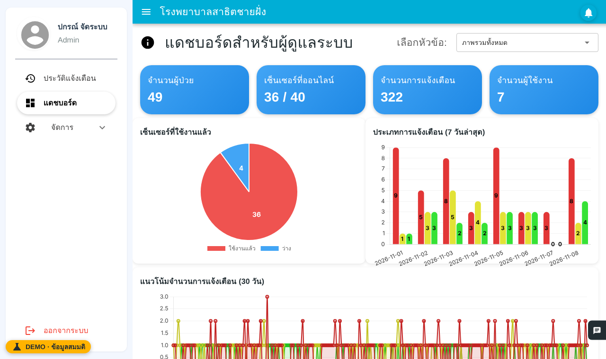
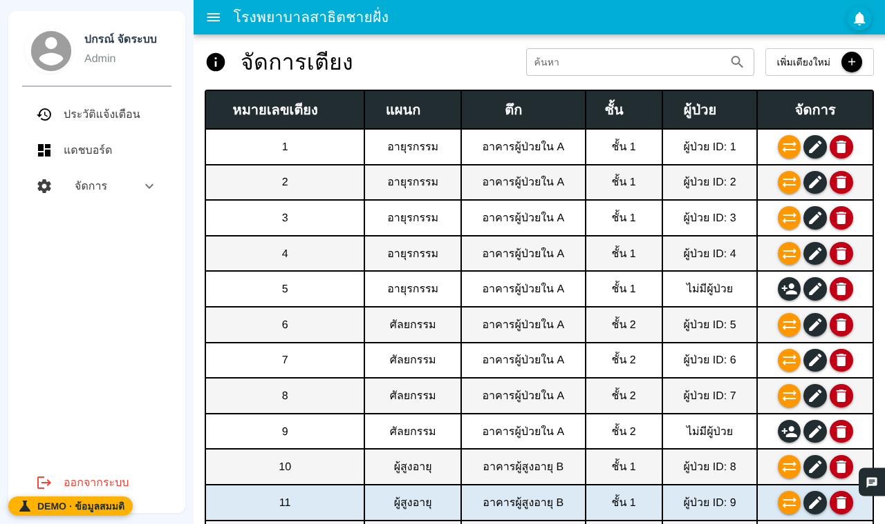
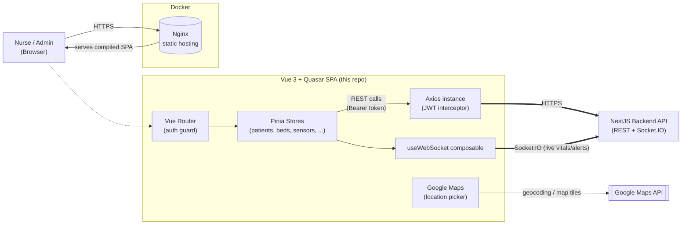

<div align="center">

# Smart Ward — Nurse & Admin Dashboard (Frontend)
### แดชบอร์ดสำหรับพยาบาลและผู้ดูแลระบบติดตามเตียงผู้ป่วย

**A real-time Vue 3 dashboard that turns live patient-vitals streams into the alerts and workflows a nursing team actually needs.**
**แดชบอร์ด Vue 3 แบบเรียลไทม์ที่แปลงข้อมูลสัญญาณชีพผู้ป่วยแบบสดให้กลายเป็นการแจ้งเตือนและ workflow ที่ทีมพยาบาลใช้งานได้จริง**

[English](#english) · [ภาษาไทย](#thai)


</div>

---

## Live demo · ทดลองใช้งาน

**[skez.codes/demo/smartbed](https://skez.codes/demo/smartbed/)** — runs entirely in your browser with **fictional data**, no backend needed. Pick a role on the login page (all passwords `demo1234`):

| Role | Login | Lands on |
|---|---|---|
| Nurse (Internal Medicine) | `nurse` | live patient cards, alert bell |
| Admin | `admin` | admin dashboard, beds, users, sensors, locations |
| Super admin | `superadmin` | everything |
| Reception | `reception` | patient registration |
| Technician | `tech` | sensor management |

Every button works — add/edit/delete, assign/transfer/discharge, confirm alerts — against an in-browser copy of the database that is saved in your browser (use **DEMO → รีเซ็ตข้อมูลเดโม** to start over). Heart rate, SpO₂ and posture are a synthetic signal, not recorded patient data. The Gemini chatbot gives canned answers in the demo.



| | |
|---|---|
|  |  |
|  |  |

**Run the real stack instead** (NestJS + MySQL + MQTT broker + sensor simulator, same fictional data): see [backend_bedproject → Try it](https://github.com/5kez/backend_bedproject#-try-it) — one `docker compose` command or one click in GitHub Codespaces.

<details>
<summary>How the in-browser demo works</summary>

- `npm run build:demo` builds with `VITE_DEMO=true` into `dist/demo`. The flag is a build-time constant, so none of the demo code is in the normal build.
- [`src/demo/server.ts`](src/demo/server.ts) is a browser port of the NestJS REST API: same routes, in the same order Nest matches them, returning the same JSON shapes. It plugs in as an axios adapter, so the pages and stores are unchanged. The shapes were checked against the real backend running on the same seed.
- [`src/demo/realtime.ts`](src/demo/realtime.ts) ports the backend's alert rules (PatientGateway + NotificationService) and feeds a fake Socket.IO client with `patientVitalsUpdate` / `newNotification` events.
- The seed is generated by the backend's [`db/seed/build-seed.mjs`](https://github.com/5kez/backend_bedproject/blob/main/db/seed/build-seed.mjs), which writes both the MySQL seed and [`src/demo/dataset.json`](src/demo/dataset.json).

ระบบเดโมทำงานในเบราว์เซอร์ทั้งหมดด้วยข้อมูลสมมติ ทุกปุ่มทำงานจริงกับฐานข้อมูลจำลองที่เก็บในเบราว์เซอร์ ส่วนค่าชีพจร/SpO₂/ท่านอนเป็นสัญญาณจำลอง
</details>

---

## Team & My Role · ทีมและบทบาทของผม

This system was built as a **senior project by a team of 7 students** at the Faculty of Informatics, Burapha University (2025).
The original team repository, with the full commit history, is on GitLab: [8bit-bed-sensor/bed-sensor-frontend](https://gitlab.com/8bit-bed-sensor/bed-sensor-frontend).
This GitHub repository is my **portfolio copy**, re-published with a fresh history — so the first commit contains the whole team's code, not only mine.

**What I built in the original team project (Tham Kaeoket):**
- MQTT ingestion service — per-sensor topic binding by MAC address, SpO2 / heart-rate streams, reconnect & resubscribe
- Socket.IO gateways that push live vitals and alerts to the dashboard
- Notification system — per-patient settings, default templates, alert history
- Password hashing (bcrypt), change-password flow, patient image upload with auto-cleanup
- LSTM posture / bed-exit classifier (trained and tuned myself; 99% accuracy at 25 timesteps)

**What I added in this portfolio copy (Aug 2026):**
- Removed a hard-coded API key and fixed the missing JWT `Authorization` header across the app
- Multi-stage Dockerfile served by Nginx
- GitHub Actions CI (lint, type-check, build), replacing the original GitLab CI
- Code clean-up and this README

**Nov 2026 — demo + bug fixes found while clicking through every page:**
- In-browser demo mode (above) and a self-host build behind nginx (`nginx.selfhost.conf`)
- Fixed: patient page crash (settings shape), nurses seeing other departments' patients, HeartRate/SpO₂ alert titles swapped, posture labels 4/5 swapped, discharge not freeing the bed, bed moves not recorded in assignment history, new users linked to the wrong profile, every user shown as Inactive, patient registration failing on MySQL (null room/floor/admit date), sensors impossible to edit (own MAC flagged as duplicate), silent failures when deleting in-use buildings/sites

Other modules (for example the LLM / Text-to-SQL assistant, dashboards and most CRUD modules) were built by my teammates.

> โปรเจกต์นี้เป็นโปรเจกต์จบของทีม 7 คน (คณะวิทยาการสารสนเทศ มหาวิทยาลัยบูรพา) repo นี้เป็นสำเนาสำหรับพอร์ตโฟลิโอของผม ส่วนที่ผมทำระบุไว้ด้านบน ส่วนอื่นเป็นผลงานของเพื่อนร่วมทีม


---

<a id="english"></a>
## EN — English

### Overview

**Smart Ward Dashboard** is the frontend for a hospital bed-monitoring platform. It's a single-page Vue 3 + Quasar application that gives nurses and administrators a live view of every patient, bed, and sensor across a hospital: real-time vitals and alerts pushed over WebSockets, bed/patient assignment workflows, department & building management, and analytics dashboards (Chart.js / ECharts) — all consuming the companion [NestJS backend](https://github.com/5kez/backend_bedproject).

> This repository is the **frontend only**. It talks to the backend exclusively over REST (Axios) and Socket.IO.

### Key Features & Engineering Highlights

Each item below reflects a real problem found and fixed while hardening this codebase — not just a feature list.

| Feature | Technical Challenge Solved |
|---|---|
| **Consolidated, authenticated API layer** | The app had **two independent Axios instances** — the shared one never actually attached a JWT (its interceptor was a no-op), and a second one read the token from the wrong `localStorage` key. In practice, **most of the app's ~20 Pinia stores were calling the backend with zero `Authorization` header.** Consolidated everything onto a single instance with a working auth interceptor and a 401 handler that clears the stale session. |
| **Real-time vitals & alerts** | A dedicated `useWebSocket` composable subscribes to the backend's Socket.IO gateway for `patientVitalsUpdate` / `newNotification` events, keeping bed cards and alert lists live without polling. |
| **Bed assignment & transfer workflows** | Dialog-driven assign / transfer / discharge flows with department-matching validation, so a patient can't be assigned to a bed in a different department by mistake. |
| **Removed unused MQTT client** | A hand-rolled composable that manually built raw MQTT CONTROL packets over a plain `WebSocket` duplicated the backend's own real-time channel and was never imported anywhere — dead code, removed. |
| **Type-safe API boundaries** | Replaced ad-hoc `as any` casts scattered across bed/patient/department forms with the fields the shared TypeScript models already declared, which also surfaced a couple of real bugs (a bed→department lookup was reading a field path that never existed on the API response). |
| **Consistent, gated logging** | Migrated dozens of raw `console.log`/`console.error` calls to a shared `logger` utility that respects the `VITE_ENABLE_LOGGING` flag, so production builds don't spam the browser console. |
| **Production-ready containerization** | Multi-stage Docker build serving the compiled SPA via Nginx with security headers, gzip, static-asset caching, and a `/health` endpoint for orchestrators. |

### System Architecture



**How it flows:** the browser loads the compiled SPA from **Nginx**; Vue Router's global guard blocks unauthenticated access to protected routes; every data-fetching action goes through **Pinia stores**, which call the backend exclusively through one shared **Axios instance** that automatically attaches the JWT from `localStorage` and clears it on a `401`; a separate **`useWebSocket`** composable keeps a live Socket.IO connection to the same backend for real-time vitals and alert push, so bed/patient cards update instantly without any polling.

### Local Setup Guide (Docker-first)

This project ships with a **multi-stage Dockerfile** that builds the Quasar SPA and serves it through Nginx — no Node.js runtime needed in production.

**Prerequisites:** [Docker Desktop](https://www.docker.com/products/docker-desktop/).

```bash
# 1. Clone the repository
git clone <repository-url>
cd bed-sensor-frontend

# 2. Create your local environment file
cp .env.example .env
# → point VITE_API_BASE_URL / VITE_WEBSOCKET_URL at your running backend,
#   and set VITE_GOOGLE_MAPS_API_KEY if you use the location picker

# 3. Build and run the container
docker build -t bed-sensor-frontend .
docker run -p 8080:80 --env-file .env bed-sensor-frontend
```

> **Note:** Vite environment variables are baked into the JS bundle **at build time**, not read at container start. If you need different `VITE_*` values per environment, rebuild the image (`--build-arg` / a build-time `.env.production`) rather than relying on `docker run -e`.

Once running:
| Resource | URL |
|---|---|
| App | `http://localhost:8080` |
| Health check | `http://localhost:8080/health` |

<details>
<summary><strong>Running without Docker (local Node.js)</strong></summary>

```bash
npm install
cp .env.example .env.development   # or edit the existing .env.development
npm run dev          # hot-reload dev server (quasar dev)
npm run build        # production build -> dist/spa
```
</details>

### Environment Variables

All configuration is driven by `VITE_*` environment variables — copy the template and fill in what your environment needs:

```bash
cp .env.example .env
```

| Variable | Purpose | Required |
|---|---|:---:|
| `VITE_API_BASE_URL` | Base URL of the backend REST API | Yes |
| `VITE_WEBSOCKET_URL` | Base URL for the Socket.IO real-time connection | Yes |
| `VITE_GOOGLE_MAPS_API_KEY` | Google Maps key used by the site/building location picker (restrict it by HTTP referrer in Google Cloud Console) | for map features |
| `VITE_MQTT_BROKER_HOST` / `_PORT` / `_WEBSOCKET_PORT` / `_PROTOCOL` | Reserved for a future direct-MQTT client; not used by any active code path today | ⬜ |
| `VITE_APP_NAME` / `VITE_APP_VERSION` | Branding shown in the UI | ⬜ |
| `VUE_ROUTER_MODE` / `VUE_ROUTER_BASE` | Router history mode (`hash` for static hosting) and base path | ⬜ |
| `VITE_ENABLE_DEBUG` / `VITE_ENABLE_LOGGING` | Toggle the shared `logger` utility's debug/console output | ⬜ |
| `VITE_TOKEN_STORAGE_KEY` / `VITE_REFRESH_TOKEN_KEY` | `localStorage` keys used to persist the auth session | ⬜ |
| `VITE_NOTIFICATION_TIMEOUT` / `VITE_WEBSOCKET_RECONNECT_*` | Real-time UX tuning (toast duration, reconnect attempts/delay) | ⬜ |
| `VITE_MAX_FILE_SIZE` / `VITE_ALLOWED_FILE_TYPES` | Client-side upload validation limits | ⬜ |
| `VITE_ITEMS_PER_PAGE` / `VITE_TABLE_ROWS_PER_PAGE` / `VITE_CHART_REFRESH_INTERVAL` | UI/table/chart defaults | ⬜ |

### Code Quality & CI

```bash
npm run lint          # ESLint (Vue + TypeScript)
npx vue-tsc --noEmit   # type-check (strict mode, exactOptionalPropertyTypes)
npm run format         # Prettier
```

GitHub Actions (`.github/workflows/ci.yml`) runs lint + type-check + build on every push/PR, and builds (and on `main`, publishes to GHCR) the production Docker image.

### License

Private / proprietary. All rights reserved.

---

<a id="thai"></a>
## 🇹🇭 ภาษาไทย

### ภาพรวมโครงการ

**Smart Ward Dashboard** คือ frontend ของแพลตฟอร์มติดตามเตียงผู้ป่วยในโรงพยาบาล เป็นแอปพลิเคชัน Vue 3 + Quasar แบบ single-page ที่ให้พยาบาลและผู้ดูแลระบบเห็นภาพรวมของผู้ป่วย เตียง และเซนเซอร์ทั้งหมดแบบเรียลไทม์: สัญญาณชีพและการแจ้งเตือนที่ส่งผ่าน WebSocket, workflow การจัดเตียง/ย้ายผู้ป่วย, การจัดการแผนก/อาคาร และ dashboard วิเคราะห์ข้อมูล (Chart.js / ECharts) — เชื่อมต่อกับ [NestJS backend](https://github.com/5kez/backend_bedproject) คู่กัน

> Repository นี้เป็นส่วน **frontend เท่านั้น** ติดต่อกับ backend ผ่าน REST (Axios) และ Socket.IO เท่านั้น

### ฟีเจอร์หลักและจุดเด่นทางเทคนิค

แต่ละรายการด้านล่างคือปัญหาจริงที่พบและแก้ไขระหว่างการทำความสะอาดโค้ด ไม่ใช่แค่รายการฟีเจอร์ทั่วไป

| ฟีเจอร์ | ปัญหาทางเทคนิคที่แก้ไข |
|---|---|
| **รวม API layer ให้ปลอดภัยและยืนยันตัวตนถูกต้อง** | เดิมแอปมี **axios instance แยกกันสองตัว** — ตัวที่ใช้ร่วมกันไม่เคยแนบ JWT จริง (interceptor เป็น no-op) ส่วนอีกตัวอ่าน token จาก key ผิดใน `localStorage` ผลคือ **Pinia store เกือบ 20 ตัวเรียก backend โดยไม่มี Authorization header เลย** รวมเป็น instance เดียวพร้อม interceptor ที่ทำงานจริง และมี handler จัดการตอน token หมดอายุ (401) |
| **สัญญาณชีพและการแจ้งเตือนแบบเรียลไทม์** | composable `useWebSocket` เชื่อมต่อ Socket.IO gateway ของ backend เพื่อรับ event `patientVitalsUpdate` / `newNotification` ทำให้การ์ดเตียงและรายการแจ้งเตือนอัปเดตทันทีโดยไม่ต้อง polling |
| **Workflow การจัดเตียงและย้ายผู้ป่วย** | หน้าจัดเตียง/ย้าย/จำหน่ายผู้ป่วยพร้อมตรวจสอบว่าแผนกตรงกัน ป้องกันการจัดผู้ป่วยเข้าเตียงคนละแผนกโดยไม่ตั้งใจ |
| **ลบ MQTT client ที่ไม่ได้ใช้งาน** | composable ที่เขียนขึ้นเองเพื่อสร้าง MQTT CONTROL packet ดิบผ่าน plain `WebSocket` ทำงานซ้ำซ้อนกับช่องทางเรียลไทม์ของ backend ที่มีอยู่แล้ว และไม่มีการ import ไปใช้ที่ไหนเลย — เป็น dead code จึงลบทิ้ง |
| **Type safety ที่ขอบเขต API** | แทนที่ `as any` ที่กระจายอยู่ในฟอร์มเตียง/ผู้ป่วย/แผนกด้วย field ที่ TypeScript model ประกาศไว้อยู่แล้ว ซึ่งเผยบั๊กจริงด้วย (การหา department จากเตียงอ่าน field path ที่ไม่มีอยู่จริงใน response) |
| **Logging ที่สม่ำเสมอและควบคุมได้** | ย้าย `console.log`/`console.error` แบบดิบหลายสิบจุดมาใช้ `logger` utility กลางที่เคารพ flag `VITE_ENABLE_LOGGING` ทำให้ production build ไม่ spam console ของ browser |
| **Containerization พร้อมใช้งานจริง** | Docker แบบ multi-stage build เสิร์ฟ SPA ที่ compile แล้วผ่าน Nginx พร้อม security header, gzip, cache สำหรับ static asset และ endpoint `/health` สำหรับระบบ orchestrator |

### ภาพรวมสถาปัตยกรรมระบบ

ดูแผนภาพ Mermaid ในหัวข้อ **System Architecture** ด้านบน (ใช้ร่วมกันทั้งสองภาษา)

**การทำงานโดยสรุป:** browser โหลด SPA ที่ compile แล้วจาก **Nginx**; guard กลางของ Vue Router จะกันไม่ให้เข้าถึง route ที่ต้อง login โดยไม่ได้ยืนยันตัวตน; ทุกการดึงข้อมูลผ่าน **Pinia store** ซึ่งเรียก backend ผ่าน **Axios instance เดียว** ที่แนบ JWT จาก `localStorage` ให้อัตโนมัติ และล้าง token ทิ้งเมื่อเจอ `401`; ส่วน **`useWebSocket`** composable แยกต่างหากจะเชื่อมต่อ Socket.IO กับ backend ตัวเดียวกันเพื่อรับสัญญาณชีพและการแจ้งเตือนแบบเรียลไทม์ ทำให้การ์ดเตียง/ผู้ป่วยอัปเดตทันทีโดยไม่ต้อง polling

### คู่มือการติดตั้งใช้งานบนเครื่อง Local (เน้น Docker)

โปรเจกต์นี้มาพร้อม **Dockerfile แบบ multi-stage** ที่ build Quasar SPA แล้วเสิร์ฟผ่าน Nginx — ไม่ต้องมี Node.js runtime ใน production เลย

**สิ่งที่ต้องมีก่อน:** [Docker Desktop](https://www.docker.com/products/docker-desktop/)

```bash
# 1. Clone repository
git clone <repository-url>
cd bed-sensor-frontend

# 2. สร้างไฟล์ environment ของตัวเอง
cp .env.example .env
# → กำหนด VITE_API_BASE_URL / VITE_WEBSOCKET_URL ให้ชี้ไปที่ backend ที่รันอยู่
#   และตั้งค่า VITE_GOOGLE_MAPS_API_KEY ถ้าจะใช้ location picker

# 3. Build และรัน container
docker build -t bed-sensor-frontend .
docker run -p 8080:80 --env-file .env bed-sensor-frontend
```

> **หมายเหตุ:** ตัวแปร environment ของ Vite จะถูกฝังเข้าไปใน JS bundle **ตอน build** ไม่ได้อ่านตอน container start ถ้าต้องการค่า `VITE_*` ต่างกันในแต่ละ environment ต้อง build image ใหม่ (ผ่าน `--build-arg` หรือไฟล์ `.env.production` ตอน build) ไม่ใช่ใช้ `docker run -e`

เมื่อรันขึ้นแล้ว:
| Resource | URL |
|---|---|
| แอป | `http://localhost:8080` |
| Health check | `http://localhost:8080/health` |

<details>
<summary><strong>การรันแบบไม่ใช้ Docker (Node.js บนเครื่อง local)</strong></summary>

```bash
npm install
cp .env.example .env.development   # หรือแก้ไฟล์ .env.development ที่มีอยู่
npm run dev          # dev server แบบ hot-reload (quasar dev)
npm run build        # production build -> dist/spa
```
</details>

### การตั้งค่า Environment Variables

การตั้งค่าทั้งหมดมาจากตัวแปร `VITE_*` — คัดลอกไฟล์ตัวอย่างแล้วกรอกค่าที่ต้องใช้:

```bash
cp .env.example .env
```

| ตัวแปร | หน้าที่ | จำเป็น |
|---|---|:---:|
| `VITE_API_BASE_URL` | Base URL ของ backend REST API | Yes |
| `VITE_WEBSOCKET_URL` | Base URL สำหรับเชื่อมต่อ Socket.IO แบบเรียลไทม์ | Yes |
| `VITE_GOOGLE_MAPS_API_KEY` | Google Maps key สำหรับเลือกตำแหน่งของสถานที่/อาคาร (ควร restrict ด้วย HTTP referrer ใน Google Cloud Console) | ถ้าใช้ฟีเจอร์แผนที่ |
| `VITE_MQTT_BROKER_HOST` / `_PORT` / `_WEBSOCKET_PORT` / `_PROTOCOL` | สำรองไว้สำหรับ MQTT client โดยตรงในอนาคต ปัจจุบันยังไม่มีโค้ดส่วนไหนใช้งานจริง | ⬜ |
| `VITE_APP_NAME` / `VITE_APP_VERSION` | ชื่อแบรนด์ที่แสดงใน UI | ⬜ |
| `VUE_ROUTER_MODE` / `VUE_ROUTER_BASE` | โหมด history ของ router (`hash` สำหรับ static hosting) และ base path | ⬜ |
| `VITE_ENABLE_DEBUG` / `VITE_ENABLE_LOGGING` | เปิด/ปิด debug/console output ของ `logger` utility กลาง | ⬜ |
| `VITE_TOKEN_STORAGE_KEY` / `VITE_REFRESH_TOKEN_KEY` | key ใน `localStorage` ที่ใช้เก็บ session การล็อกอิน | ⬜ |
| `VITE_NOTIFICATION_TIMEOUT` / `VITE_WEBSOCKET_RECONNECT_*` | ปรับแต่ง UX เรียลไทม์ (ระยะเวลา toast, จำนวนครั้ง/ดีเลย์ในการ reconnect) | ⬜ |
| `VITE_MAX_FILE_SIZE` / `VITE_ALLOWED_FILE_TYPES` | ขีดจำกัดการตรวจสอบไฟล์อัปโหลดฝั่ง client | ⬜ |
| `VITE_ITEMS_PER_PAGE` / `VITE_TABLE_ROWS_PER_PAGE` / `VITE_CHART_REFRESH_INTERVAL` | ค่าเริ่มต้นของ UI/ตาราง/กราฟ | ⬜ |

### คุณภาพโค้ดและ CI

```bash
npm run lint          # ESLint (Vue + TypeScript)
npx vue-tsc --noEmit   # ตรวจสอบ type (strict mode, exactOptionalPropertyTypes)
npm run format         # Prettier
```

GitHub Actions (`.github/workflows/ci.yml`) รัน lint + type-check + build ทุกครั้งที่ push/PR และ build (พร้อม publish ขึ้น GHCR เมื่ออยู่บน branch `main`) Docker image สำหรับ production

### สัญญาอนุญาต

Private / proprietary สงวนสิทธิ์ทั้งหมด
